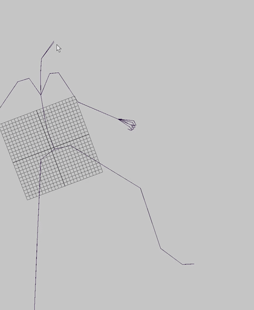
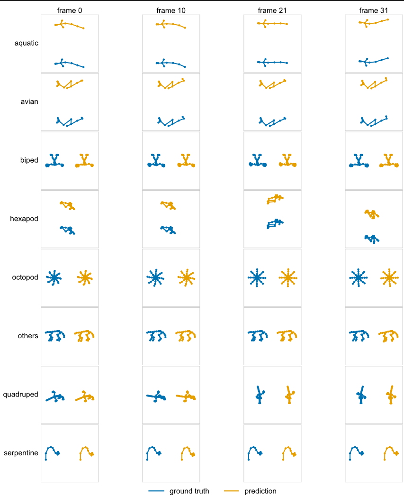

# TopoMotion

**구조가 다른 입력을 하나의 모델로 처리하는 그래프 기반 모션 표현 모델**

개인 연구 · 2026.04–진행 중 · 이 저장소는 소개용이며 코드는 비공개입니다.

  
   Maya 플러그인에서 복원 결과를 재생한 화면 (<a href="assets/maya_reconstruction.mp4">원본 영상</a>)

## 개요

관절 수와 연결 구조가 다른 캐릭터 골격마다 모델을 따로 만드는 대신, 골격을 그래프로 입력받아 하나의 모델로 모션을 압축·복원합니다.

- **입력 표현**: 관절 = 노드, 부모–자식 연결 = 엣지. 뼈 길이·오프셋을 정적 특징으로 사용
- **모델**: GNN 인코더 + 관절별 코드(관절 수에 따라 표현 크기가 늘어남), FK로 회전과 위치를 함께 학습
- **이질 골격 배치**: 관절 수가 다른 그래프를 분리 그래프로 묶어 공유 가중치로 학습
- **배포**: ONNX로 변환해 PyTorch 없이 CPU에서 추론, Maya 플러그인으로 통합

## 결과

| 항목 | 결과 |
|---|---|
| 학습 데이터 | 941개 리그 · 8개 형태 범주 · 570개 골격 구조 |
| 처음 보는 골격 167개 | 회전 복원 오차 **0.29°** (정적 특징 정규화를 추가한 최종 구성) |
| 같은 학습 조건의 구조 비교 | 고정 크기 코드 37.6° → 관절별 코드 **0.45°** |
| 논문 단계 (7개 골격 구성, 관절 11~26개) | 회전 0.62° · 위치 2.53 mm (평균 자세 기준선 7.25° · 32.0 mm, 학습 구간 기준) |

회전 오차는 범주별 중앙값을 집계한 macro 기준입니다.

  
   형태 범주별 정답(파랑)과 복원 결과(주황)

## 배포 검증 (Maya)

| 항목 | 결과 |
|---|---|
| 플러그인 로드 · 명령 등록 · 해제 | 통과 |
| 라이브러리 모션 15개 선택 · 재생 | 통과 |
| 리그 추출 → 적용 왕복 | 행렬 차이 2.8×10⁻¹⁶ |
| PyTorch 없는 추론 경로 | 5.2 ms |
| 모델 크기 | 약 2 MB (설치 패키지 65.7 MB, 오프라인 실행) |

추론 시간은 Maya 헤드리스 환경에서 대표 입력(31관절 · 32프레임)으로 측정한 모델 추론 시간이며, 파일 읽기와 씬 갱신은 포함하지 않습니다.

## 다음 단계: 생성

복원과 달리, 같은 표현에서 새 모션을 생성하는 단계는 아직 기준선을 넘지 못했습니다. 디퓨전 생성 모션의 품질 점수(에너지 거리)는 5.31로, 가장 비슷한 다른 캐릭터의 실제 모션을 쓰는 기준선 5.16보다 나빴습니다. 원인을 실험으로 좁혀 생성기를 다시 설계하고 있습니다.

## 논문

- **ISPACS 2026 Workshop** · 제1저자 — *A Topology-Agnostic Motion Reconstruction Pipeline for Skeleton-Diverse Character Animation*

## 기술

Python · PyTorch · PyTorch Geometric · GATv2 · RVQ · NumPy · ONNX Runtime · Maya
